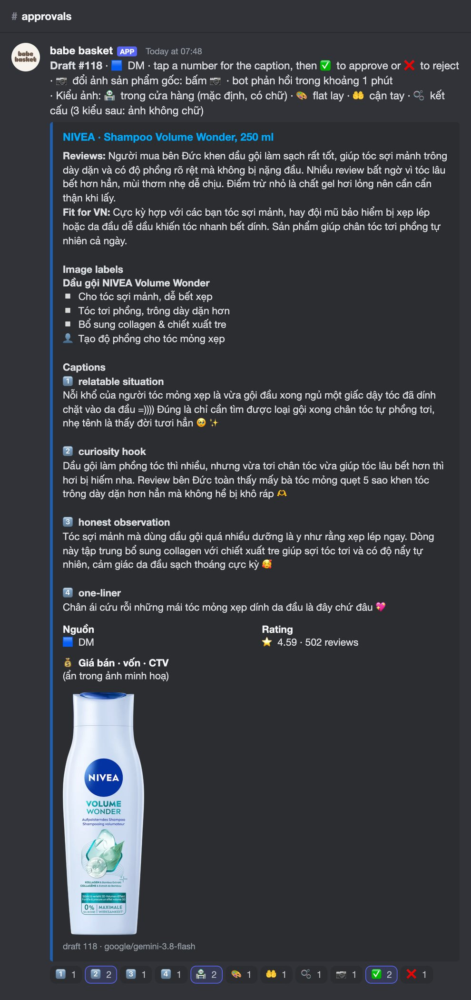
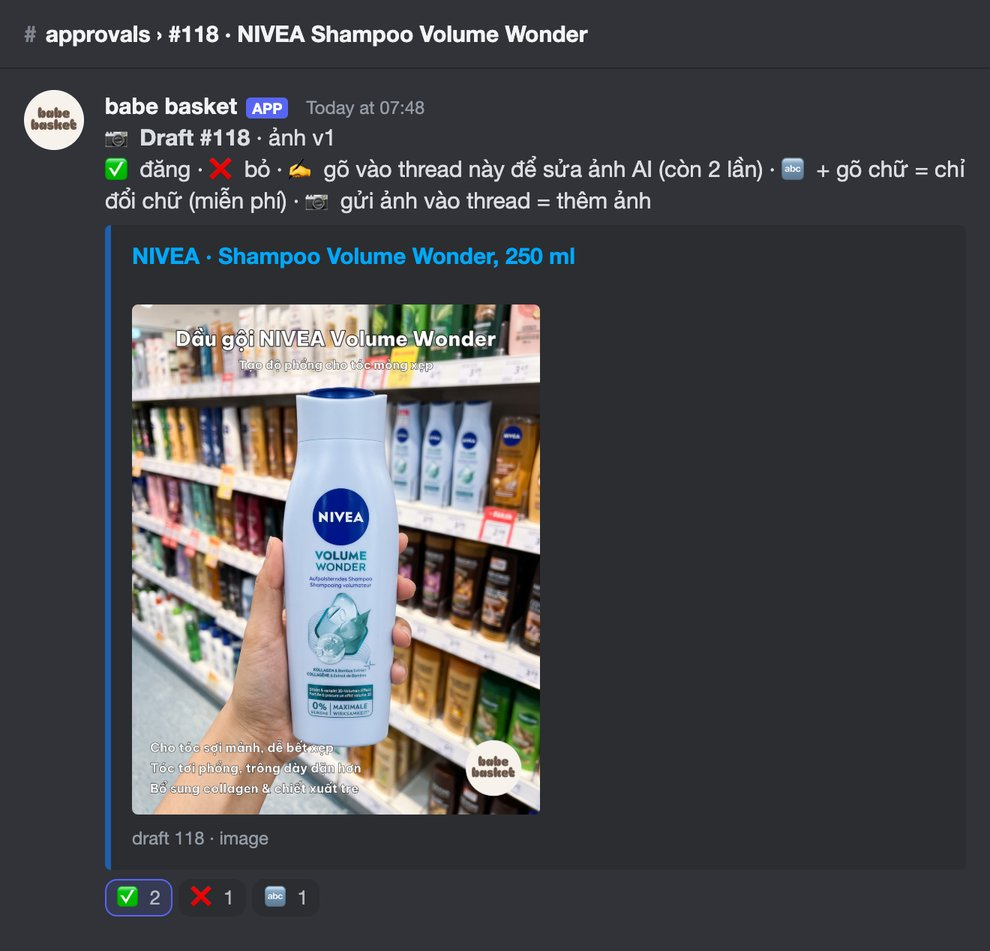
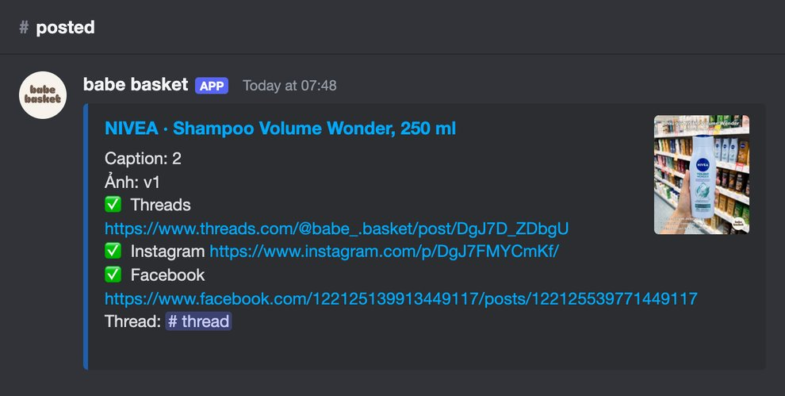

<p align="center">
  
</p>

<h1 align="center">babe basket automation</h1>

<p align="center">
  Finds well-reviewed products at German drugstores, writes Vietnamese posts about them,
  and publishes each one once the owner approves it in Discord.
</p>

---

**babe basket** sells German drugstore products (dm, Rossmann) to young Vietnamese women. This repository
handles the shop's daily posting:
- it picks 11 good products every morning;
- it writes captions in the shop's voice and works out a sale price in VND;
- it makes a post image and, where it helps, a carousel of real shop photos;
- it publishes to Threads, Instagram and Facebook.

**Nothing is published without a ✅ in Discord.**


## A day with babe basket

### 1. 07:00: today's picks arrive as caption cards

The bot reads dm and Rossmann (prices, ratings, review texts and the public Rossmann offers) and picks
11 products for the day:

| Group | Per day | Bar |
|---|---|---|
| Hair: shampoo, conditioner, masks, leave-in, oils, styling | 5 | 4.0★, 10 reviews |
| Body: lotion, deo, hand and foot care, shower gel, scrub, bath, intimate wash | 3 | 4.0★, 10 reviews |
| Extra: sun care, skincare, beauty supplements, gift sets, men's products | 2 | 4.5★, 100 reviews |
| Make-up: coloured lip products | 1 | 4.0★, 10 reviews |

The picks follow a few rules:
- A shampoo is posted together with its matching conditioner from the same line, both in one post.
- One pick a day may be a new, still unrated product from a brand that rates well (marked 🆕).
- At most 2 products per brand a day, and no product again within 45 days.
- Products over €10 rank lower, and products over €20 are skipped (gift sets up to €40).
- Some products are never picked: aerosols and anything flammable (they can't be shipped to Vietnam),
  accessories, electrical devices, perfume and non-beauty supplements.

Each product gets its own card in **#approvals** with the store's packshot, a review summary, the text for the
image and four captions. The card also shows prices for the owner only: shelf price, coupon, cost, suggested
sale price, CTV price and deposit. The captions themselves never mention a price; they invite customers to
inbox the shop.

The owner taps a number to pick a caption and an emoji to pick the image style, then taps ✅. 📷 swaps the
product photo first. ❌ drops the draft, and the next `check` drafts a replacement, from the same group when it can.

<p align="center"></p>

### 2. The post image is made after approval

The image is made only after the caption is approved, so no image is wasted on a rejected post. It is the
real packshot placed in one of four styles, with the shop's logo:

| Emoji | Style |
|---|---|
| 🏪 K0 (default) | in a drugstore aisle, with a title and key points |
| 🎨 K1 | flat lay on a pastel surface |
| 🤲 K3 | held in a hand against a soft studio background |
| 🫧 K4 | texture shot, using a real shop photo of the contents |


- **The packaging stays true.** Before drawing, the text model writes down the real packaging (container,
  colours, cap or pump). Afterwards, it compares the result with the packshot and warns on the card when a
  customer would notice a difference.
- **Images are free by default.** They come from Gemini in Chrome on the owner's account, at most 30 a day.
  The paid OpenRouter image model is the alternative. When a cap is reached or the image fails, the post
  gets a plain background instead.

### 3. Review in the draft's own thread

The image card opens a thread under its caption card, so every version and edit of a post stays in one place.
The owner can:
- type what to change ("sản phẩm to hơn, nền sáng hơn") to get a new AI version;
- tap 🔤 to change only the words, which is free;
- pick the supporting photos by number from the sheet under the card, tap 0️⃣ for the main image only,
  or 📷 to add their own photo;
- tap ✅ to post, or ❌ to drop it.

The bot suggests supporting photos by product kind: shade photos for make-up, the real box for gift sets,
a texture photo for creams, the ingredients label for supplements.

<p align="center"></p>

### 4. Published, with a receipt in #posted

Within a minute of ✅ the post goes out to every enabled platform. **#posted** gets one summary per post:
the caption and image version that were used, and a link or the error for each platform.

<p align="center"></p>

## Coupons

App coupons sit behind the owner's login, so the bot never scrapes them. To add them:
- post a screenshot of the dm or Rossmann app's coupon tab in **#coupons**;
- or type a short note such as `dm 20% Balea đến 30.11`.

The next `check` reads the coupons and replies with what it understood; ❌ on that reply deletes them. While
a coupon is valid, the products it covers rank higher and their cost on the card goes down.

Discounts from Rossmann's public offers pages raise a product's ranking for 7 days. Their price already
includes the discount.

## Quick start

```sh
python3 -m babebasket try dm 3050111    # one product end to end, printed; no Discord, no DB
python3 -m babebasket daily             # scrape + draft + send caption cards
python3 -m babebasket check             # read approvals, make images, publish ready posts
python3 -m unittest                     # tests, no network
```

Requirements:
- Python 3.11+;
- `pip install -r requirements.txt` (into `.venv`);
- secrets in `.env` (see `.env.example`);
- everything else in `config.toml`.

| Other commands | What they do |
|---|---|
| `scrape`, `shortlist`, `draft`, `post` | the steps of `daily`, one at a time |
| `publish` | post the drafts whose caption and image are both approved |
| `costs [--days 30]` | what the AI calls cost, per stage and draft |
| `notify "…"` | send a message to the approval channel |
| `gemini-login`, `gemini-test` | sign in to Gemini in Chrome; make one test image |
| `facebook-setup` | turn a user token into the Page's never-expiring token |

## How it runs

| What | When | How |
|---|---|---|
| `daily`: scrape, pick, draft, send cards | 07:00 Europe/Berlin | n8n in Docker, over a restricted SSH key |
| `check`: read approvals and coupons, make images, publish | every minute | LaunchAgent `com.babebasket.check` in the logged-in session |

`check` must run in the logged-in session because Gemini in Chrome refuses to start over SSH.

Each run logs to `data/logs/`, and a failed run posts a ⚠️ to Discord. Rossmann gets one retry when a page
comes back empty. A card that gets no decision within 3 days expires on its own.

Every AI call is recorded with its cost. Paid images are capped per post and per day.

## Documentation

| Read | For |
|---|---|
| [Approving in Discord](docs/approving.md) | every emoji, the image styles, choosing the photo set, draft statuses |
| [Post images](docs/post-images.md) | how the image is made, fidelity check, costs, the free Gemini-in-Chrome backend |
| [What gets picked](docs/picking.md) | product groups, pairs, the price formula, coupons (#coupons), the never-pick list, data sources |
| [Setup and scheduling](docs/setup.md) | `.env`, Facebook and Instagram, n8n, the `check` LaunchAgent |
| [Content guide](docs/content-guide.md) | the shop's voice and caption rules |
| [Backlog](docs/BACKLOG.md) | parked ideas, not built |
| [Privacy policy](docs/privacy-policy.md) · [Data deletion](docs/data-deletion.md) | for the Meta app |
