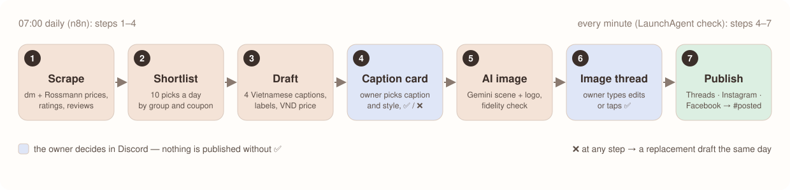
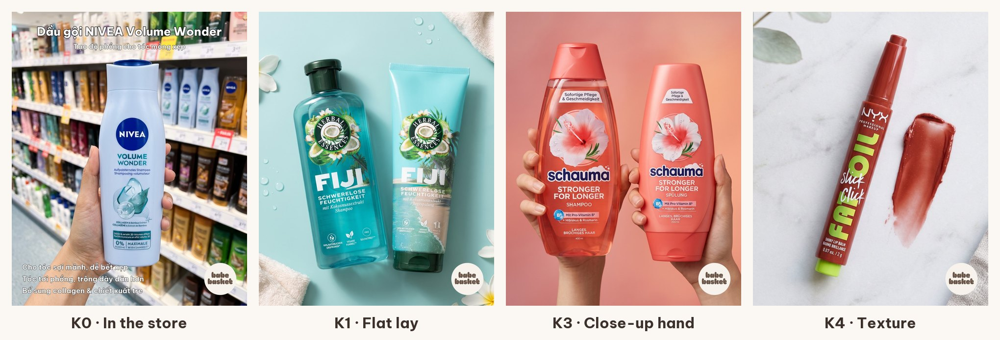

<p align="center">
  
</p>

<h1 align="center">babe basket automation</h1>

<p align="center">
  Finds well-reviewed products at German drugstores, writes Vietnamese posts about them,
  and publishes each one once the owner approves it in Discord.
</p>

---

**babe basket** sells German drugstore products (dm, Rossmann) to young Vietnamese women. This repository
handles the shop's daily posting:
- it picks good products every morning;
- it writes captions in the shop's voice and works out a sale price in VND;
- it makes a post image;
- it publishes to Threads, Instagram and Facebook.

**Nothing is published without the owner's ✅ in Discord.**



## A day with babe basket

### 1. 07:00: today's picks arrive as caption cards

The bot reads dm and Rossmann (prices, ratings, review texts and coupons) and picks about 10 products for the
day. Each product gets its own card in **#approvals**, with a review summary, the text for the image and four
captions. The card also shows prices for the owner only: shelf price, cost, suggested sale price, CTV
price and deposit.

The owner taps a number to pick a caption and an emoji to pick the image style, then taps ✅. ❌ drops the draft,
and a replacement arrives on the next run.

<p align="center"></p>

### 2. The post image is made after approval

The image is made only after the caption is approved, so no image is wasted on a rejected post. It is a real
packshot placed in one of four styles, with the shop's logo. A check compares the result with the real packaging
and warns the owner when something looks different.



### 3. Review in the draft's own thread

The image card opens a thread under its caption card, so every version and edit of a post stays in one place.
The owner can:
- type what to change ("sản phẩm to hơn, nền sáng hơn") to get a new AI version;
- tap 🔤 to change only the words, which is free;
- send a photo to add it to the post;
- tap ✅ to post.

<p align="center"></p>

### 4. Published, with a receipt in #posted

Within a minute of ✅ the post goes out to every enabled platform. **#posted** gets one summary per post:
the caption and image version that were used, and a link or the error for each platform.

<p align="center"></p>

## Quick start

```sh
python3 -m babebasket try dm 3050111    # one product end to end, printed; no Discord, no DB
python3 -m babebasket daily             # scrape + draft + send caption cards
python3 -m babebasket check             # read approvals, make images, publish ready posts
python3 -m unittest                     # tests, no network
```

Requirements:
- Python 3.11+;
- `pip install -r requirements.txt` (into `.venv`);
- secrets in `.env` (see `.env.example`);
- everything else in `config.toml`.

The other commands are `scrape`, `shortlist`, `draft`, `post`, `publish` and `costs`.

## How it runs

| What | When | How |
|---|---|---|
| `daily`: scrape, pick, draft, send cards | 07:00 Europe/Berlin | n8n in Docker, over a restricted SSH key |
| `check`: read approvals, make images, publish | every minute | LaunchAgent `com.babebasket.check` in the logged-in session |

Each run logs to `data/logs/`. When a run fails, it posts a ⚠️ to Discord. A card that gets no decision within 3
days expires on its own.

## Documentation

| Read | For |
|---|---|
| [Approving in Discord](docs/approving.md) | every emoji, the image styles, choosing the photo set, draft statuses |
| [Post images](docs/post-images.md) | how the image is made, fidelity check, costs, the free Gemini-in-Chrome backend |
| [What gets picked](docs/picking.md) | product groups, pairs, the price formula, coupons (#coupons), the never-pick list, data sources |
| [Setup and scheduling](docs/setup.md) | `.env`, Facebook and Instagram, n8n, the `check` LaunchAgent |
| [Content guide](docs/content-guide.md) | the shop's voice and caption rules |
| [Privacy policy](docs/privacy-policy.md) · [Data deletion](docs/data-deletion.md) | for the Meta app |
